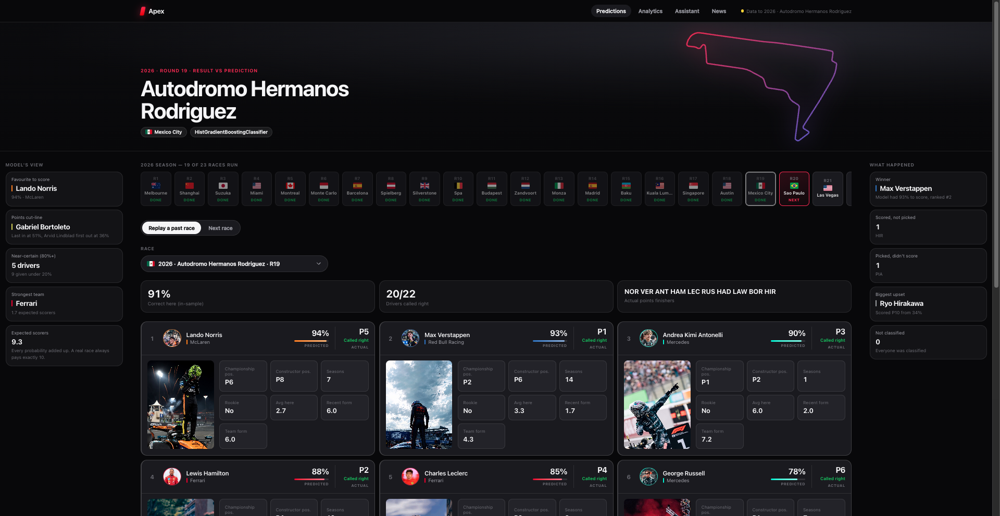

# Apex
## Formula 1 Points-Finish Predictor

A machine learning project that predicts whether a Formula 1 driver will finish in the points (top 10) at a given race, using only information available before qualifying. It started as an NTU SC1015 (Introduction to Data Science and AI) mini-project on the Singapore Grand Prix and has grown into a trained multi-circuit model, a FastAPI web app with a live dashboard, and a Claude-powered race analyst.



## Highlights

- **Leakage-aware evaluation.** Models are tested on later seasons than they were trained on, and class balancing is applied to the training set only.
- **Pre-qualifying features only.** Grid position is a strong predictor, but it isn't known until qualifying, so it is deliberately excluded. The model can predict a race as soon as the previous one ends.
- **Four model families compared.** Random Forest, Logistic Regression, SVM and Histogram Gradient Boosting, each as a baseline and as a grid-searched version.
- **Single-circuit vs multi-circuit.** The pipeline checks whether training on every circuit improves predictions for Singapore, and exports whichever model scores better.
- **Self-updating web app.** A background job checks for new race results, fetches them, retrains the model in a separate process and swaps it in without restarting the server.
- **Two clearly separated paths.** Predictions are deterministic (features into the trained model). The chat assistant is agentic, but Claude can only call a fixed set of functions over the same data and never computes a prediction itself.

## Results

Target: `points_finish`, whether the driver finished in the top 10. The multi-circuit model trains on every circuit from 2008-2021 and is tested on the Singapore Grand Prix only, using the most recent editions (2022-2026, 102 driver entries).

| Model | Singapore-only (tuned) | Multi-circuit (tuned) |
|---|---|---|
| Random Forest | **71.3%** | 84.3% |
| Logistic Regression | 68.8% | 79.4% |
| SVM | 56.2% | 80.4% |
| Histogram Gradient Boosting | 62.5% | **86.3%** |

- The exported model is the multi-circuit Histogram Gradient Boosting model: 86% precision and 86% recall on both classes (about half of entries finish in the points, so a coin flip scores about 50%).
- Singapore-only models train on just 198 rows from 2008-2016, which is why they trail the multi-circuit model. Their test set is 80 rows (2017-2019 and 2022).

Numbers are from one run of `python -m f1.pipeline --data-dir data`. See Limitations before relying on them.

## Approach

1. **Data.** Historical Formula 1 results, races, drivers, qualifying, lap times and pit stops for 2008-2022 (Kaggle and official Formula 1 data) in `data/`. Later seasons are fetched from the [Jolpica-F1](https://api.jolpi.ca/ergast) API.
2. **Features** (`f1/pipeline.py`), all known before qualifying:
   - `driver_standing_before`, `constructor_standing_before`: championship position coming into the race
   - `years_experience`, `is_rookie`
   - `driver_circuit_avg_finish`: the driver's average finishing position at that circuit in earlier years
   - `driver_recent_form`, `constructor_recent_form`: average finish over the last 3 races
   - `circuit_id`, one-hot encoded
3. **Target.** `points_finish`, a top-10 finish (points are paid to P10 since 2010).
4. **Split.** Chronological: the most recent editions form the test set, so the model is never judged on a race that happened before part of its training data.
5. **Balancing.** The minority class is upsampled on the training set only, after the split.
6. **Training and selection.** Each model runs as a baseline and as a 5-fold `GridSearchCV`. The best tuned model is refit on all available data and saved to `models/model.pkl`.

Everything downstream imports its features and target from `f1/pipeline.py`, so the dashboard, the notebook and the model all use the same definitions.

### Design decision: dropping grid position

Grid position is one of the strongest predictors, but it only exists once qualifying finishes, about a day before the race. A model that needs it can only be used the day before. Excluding it costs accuracy but lets the model predict as soon as the previous race ends.

## Web app

Run from the repository root:

```bash
uvicorn webapp.main:app --reload
```

then open http://127.0.0.1:8000.

- **Predictions:** points-finish probabilities for every driver at the next race or any circuit, plus past races compared with what actually happened.
- **Analytics:** a current-season analysis of the same features the model uses. The notebook calls the same `f1/analytics.py`, so both show the same numbers.
- **News:** headlines from established motorsport outlets' RSS feeds, linked out rather than republished.
- **Race analyst chat:** a Claude tool-use assistant that answers questions through the same prediction service as the dashboard. It needs `ANTHROPIC_API_KEY`. Without a key the rest of the app works and the chat reports that it is offline.
- **Auto-update:** a background thread in the server process checks Jolpica every 3 hours. When a new race has completed it fetches the results, retrains with `f1/pipeline.py` in a subprocess (about 20-30 minutes) so the server stays responsive, and swaps the model in atomically.

Main endpoints: `/api/status`, `/api/circuits`, `/api/races`, `/api/schedule`, `/api/predictions/upcoming?circuit=...`, `/api/predictions/race/{race_id}`, `/api/analytics`, `/api/news`, `/api/chat`.

Optional environment variables: `F1_DATA_DIR`, `F1_MODEL_PATH`, `F1_CHECK_INTERVAL_SECONDS`, `F1_NEWS_TTL_SECONDS`, `F1_AGENT_MODEL`.

## Architecture



The red path is the self-update loop: the scheduler checks for a new race, saves the results, retrains the model in a separate process and swaps it in without restarting the server.

## Project structure

```
Formula1-ML/
├── f1/                      core library
│   ├── pipeline.py          features, training, model selection, export
│   ├── analytics.py         season analysis, shared by the web app and notebook
│   ├── fetch_data.py        fetches Singapore GP detail (laps, pit stops)
│   ├── fetch_all_circuits_data.py   fetches full seasons, every circuit
│   └── agent_cli.py         command-line Claude agent over the model
├── webapp/                  FastAPI app and static frontend
│   ├── main.py              routes
│   ├── predictions.py       feature building and model predictions
│   ├── model_store.py       loads and hot-reloads the model
│   ├── scheduler.py         auto-update and retrain loop
│   ├── live_data.py, news.py, photos.py, reference.py
│   ├── agent.py             Claude race analyst
│   └── static/              HTML, CSS, JS, driver photos
├── notebooks/               original SC1015 mini-project notebook
├── data/                    historical CSVs and freshly fetched seasons
├── models/                  trained model (model.pkl)
├── docs/                    architecture write-up and course slides
└── requirements.txt
```

## Getting started

Run every command from the repository root.

```bash
pip install -r requirements.txt

# Train, compare and export the model (takes several minutes)
python -m f1.pipeline --data-dir data --model-out models/model.pkl

# Optional: fetch more recent seasons first
python -m f1.fetch_all_circuits_data --years 2023 2024 2025 --out data/multi_circuit_fresh.csv
python -m f1.fetch_data --years 2023 2024 2025 --out data/singapore_fresh.csv

# Web app
uvicorn webapp.main:app --reload

# Command-line agent (needs ANTHROPIC_API_KEY)
python -m f1.agent_cli
```

A model pickled with a different scikit-learn version may not load. If `/api/status` reports that the model could not be loaded, retrain it with the first command.

The notebook is in `notebooks/`. Start Jupyter from there. It adds the repository root to its path to import the `f1` package.

The architecture write-up is in `docs/architecture.html`.

## Limitations

- **Small test set.** The held-out Singapore set is about 100 driver entries from five races, so differences of a few points are within noise.
- **Selection on the test set.** The reported best model is chosen by its held-out test accuracy, so the headline figure is slightly optimistic. A separate validation split by season would give a cleaner estimate.
- **Accuracy only.** The classes are close to balanced, so accuracy is meaningful here, but it says nothing about how well probabilities are calibrated.
- **Singapore evaluation.** The multi-circuit model is trained on all circuits but scored only on Singapore.
- **Not a betting tool.** The model uses pre-race standings and form. It doesn't model safety cars, weather, crashes or strategy.
- **Live data needs the Jolpica API.** If it is unreachable the app serves cached data.

## Data sources

- Kaggle Formula 1 datasets and official Formula 1 data (2008-2022)
- [Jolpica-F1](https://api.jolpi.ca/ergast), an Ergast-compatible API (2023 onward)
- Motorsport news RSS feeds (headlines and links only)